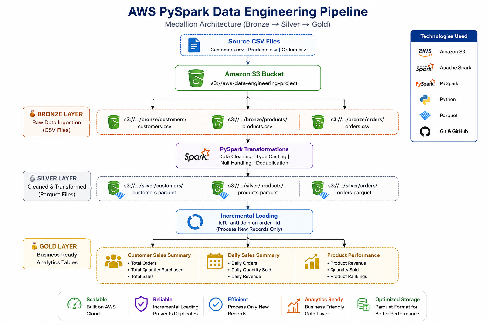
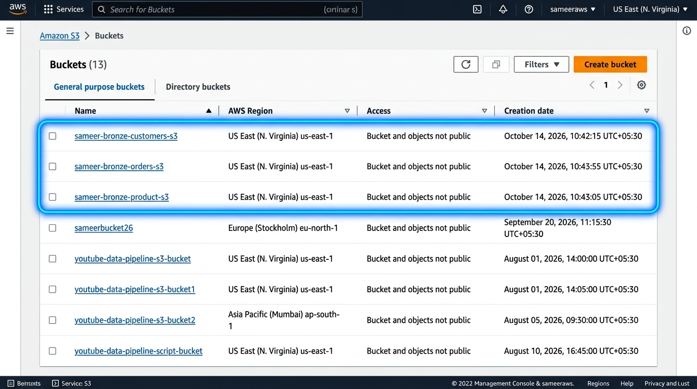
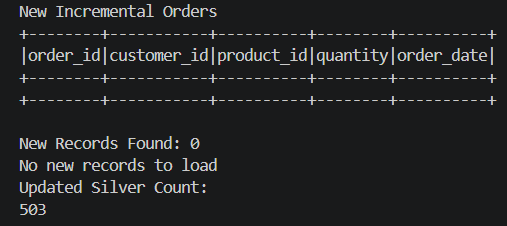

# AWS PySpark End-to-End Data Engineering Pipeline


-blueviolet?style=for-the-badge)

An enterprise-grade, cloud-native **Data Engineering Pipeline** built with **Apache Spark (PySpark)** and **Amazon S3**, implementing the **Medallion Architecture (Bronze → Silver → Gold)** with automated schema enforcement, data deduplication, and **incremental loading**.

---

## 📌 Table of Contents

- [Project Overview](#-project-overview)
- [Architecture & Data Flow](#-architecture--data-flow)
- [Tech Stack](#-tech-stack)
- [Medallion Layers](#-medallion-layers)
  - [1. Bronze Layer (Raw Ingestion)](#1-bronze-layer-raw-ingestion)
  - [2. Silver Layer (Cleaned & Standardized)](#2-silver-layer-cleaned--standardized)
  - [3. Incremental Loading Pattern](#3-incremental-loading-pattern)
  - [4. Gold Layer (Analytics & Aggregations)](#4-gold-layer-analytics--aggregations)
- [Repository Structure](#-repository-structure)
- [Setup & Installation Guide](#-setup--installation-guide)
  - [Prerequisites](#prerequisites)
  - [Step 1: Clone & Install Dependencies](#step-1-clone--install-dependencies)
  - [Step 2: AWS Credentials Setup](#step-2-aws-credentials-setup)
  - [Step 3: Run the Pipeline](#step-3-run-the-pipeline)
- [Sample Transformation Output](#-sample-transformation-output)
- [Key Features & Engineering Highlights](#-key-features--engineering-highlights)
- [Author & Contact](#-author--contact)
- [License](#-license)

---

## 🚀 Project Overview

In real-world e-commerce enterprise systems, millions of transactions arrive daily from multiple source systems. Processing this raw, unstructured, or semi-structured data requires a robust, scalable architecture that guarantees:
- **Zero Data Loss:** Original data is immutable and auditable.
- **Idempotency & Deduplication:** Prevention of duplicate order or transaction processing.
- **Cost Efficiency:** Efficient query performance via columnar storage (`Apache Parquet`) and incremental delta processing rather than full-table scans.
- **Analytics Readiness:** Business-ready dimensional summaries for BI dashboards and executive decision-making.

This project delivers an end-to-end cloud pipeline addressing all of these production requirements using **Amazon S3** and **PySpark**.

---

## 🏗️ Architecture & Data Flow

```text
      Source CSV Files (Customers, Products, Orders)
                           │
                           ▼
            ┌─────────────────────────────┐
            │   Amazon S3 (Bronze Layer)  │  ◄── Raw, Immutable CSVs
            └──────────────┬──────────────┘
                           │
                           ▼
          [ PySpark ETL & Cleaning Engine ]
            • Schema validation & casting
            • Null handling & deduplication
            • String trimming & casing
                           │
                           ▼
            ┌─────────────────────────────┐
            │   Amazon S3 (Silver Layer)  │  ◄── Optimized Snappy Parquet
            └──────────────┬──────────────┘
                           │
             ┌─────────────┴─────────────┐
             ▼                           ▼
  [ Incremental Loader ]       [ Gold Aggregator ]
   • left_anti join on IDs      • Customer 360 metrics
   • Delta-only ingestion       • Daily revenue trends
   • Append to Silver           • Product performance
             │                           │
             └─────────────┬─────────────┘
                           ▼
            ┌─────────────────────────────┐
            │    Amazon S3 (Gold Layer)   │  ◄── Analytics & BI Ready
            └─────────────────────────────┘
```



---

## 🛠️ Tech Stack

| Technology | Role in Project | Why Chosen? |
|---|---|---|
| **Amazon S3** | Cloud Object Storage / Data Lake | Industry standard, 99.999999999% durability, decoupled storage & compute |
| **Apache Spark** | Distributed Processing Engine | In-memory distributed computing capable of petabyte-scale transformations |
| **PySpark** | Pipeline Implementation | High-performance Python API leveraging Spark Catalyst Optimizer |
| **Apache Parquet** | Columnar File Format | Snappy compression, predicate pushdown, 80%+ storage cost reduction |
| **Boto3** | AWS SDK for Python | Programmatic S3 bucket management and initial data uploads |
| **Hadoop-AWS / S3A** | Spark S3 Filesystem Connector | High-throughput direct streaming between Spark executors and S3 |

---

## 🏅 Medallion Layers

### 1. Bronze Layer (Raw Ingestion)
- **Format:** CSV
- **Role:** Immutable single source of truth. Raw files ingested directly from operational databases.
- **Datasets Ingested:**
  - `customers.csv` (Customer profiles, signup dates, location)
  - `products.csv` (Product catalog, pricing, categories)
  - `orders.csv` (Transactional purchase records)



---

### 2. Silver Layer (Cleaned & Standardized)
- **Format:** Apache Parquet
- **Transformations Applied:**
  - Enforced strict typed schemas (`IntegerType`, `StringType`, `DateType`, `DoubleType`).
  - Dropped duplicate records across primary keys (`customer_id`, `product_id`, `order_id`).
  - Stripped leading/trailing whitespaces and filtered out corrupt/null primary identifiers.
  - Validated business constraints (e.g., `price > 0`, `quantity > 0`).

```text
Silver Parquet Outputs:
├── customers/       (Cleaned profiles)
├── products/        (Deduplicated catalog)
└── orders/          (Sanitized transaction logs)
```

---

### 3. Incremental Loading Pattern
Rather than reprocessing millions of historical rows on every run, the pipeline implements an efficient **Incremental Ingestion** pattern:
1. Reads existing silver transaction keys.
2. Reads newly arrived batch files from Bronze.
3. Performs a Spark **`left_anti` join** against existing keys:
   $$\text{Delta Records} = \text{New Batch} \setminus \text{Existing Silver}$$
4. Appends **only new, unseen records** to the Silver Parquet dataset.



---

### 4. Gold Layer (Analytics & Aggregations)
The Gold layer produces pre-aggregated, denormalized marts optimized for analytical queries:

#### 📊 Customer Sales Summary
Aggregates customer lifetime purchasing behavior:
- `customer_id`, `first_name`, `last_name`, `city`, `state`
- `total_orders`: Total order count per customer
- `total_quantity`: Total items bought
- `total_sales`: Lifetime customer spend

#### 📅 Daily Sales Summary
Provides daily business health metrics:
- `order_date`: Calendar date
- `daily_orders`: Volume of transactions per day
- `daily_quantity`: Total merchandise items sold
- `daily_revenue`: Total revenue collected

#### 🏆 Product Performance
Rankings and profitability analysis:
- `product_id`, `product_name`, `category`
- `quantity_sold`: Total unit sales
- `product_revenue`: Gross revenue by product
- `product_rank`: Dense ranking based on revenue contribution

---

## 📂 Repository Structure

```text
aws-data-engineering-project/
│
├── architecture/
│   └── aws-data-engineering-architecture.png   # End-to-end architecture diagram
│
├── data/
│   └── raw/                                    # Sample source CSV datasets
│       ├── customers.csv
│       ├── products.csv
│       ├── orders.csv
│       └── orders_new.csv                      # Incremental delta batch
│
├── images/
│   ├── S3-bucket.png                           # AWS S3 Data Lake screenshot
│   └── incremental-load.png                    # Incremental load demonstration
│
├── scripts/
│   ├── generate_data.py                        # Generates realistic synthetic datasets
│   ├── upload_to_s3.py                         # Uploads raw data to S3 Bronze layer
│   ├── bronze_to_silver.py                     # PySpark Bronze → Silver ETL pipeline
│   ├── incremental_load.py                     # Incremental delta loading via left_anti join
│   └── silver_to_gold.py                       # PySpark Silver → Gold analytical aggregations
│
├── .gitignore
├── requirements.txt                            # Python dependencies
└── README.md                                   # Project documentation
```

---

## ⚡ Setup & Installation Guide

### Prerequisites
- **Python:** 3.8 to 3.11
- **Java:** JDK 8, 11, or 17+ (configured in `JAVA_HOME`)
- **AWS Account:** With permissions for Amazon S3 (`AmazonS3FullAccess`)
- **AWS CLI:** Installed and configured

### Step 1: Clone & Install Dependencies

```bash
# Clone the repository
git clone https://github.com/sk-sameer20/AWS-data-engineering-project.git
cd AWS-data-engineering-project

# Install Python requirements
pip install -r requirements.txt
```

### Step 2: AWS Credentials Setup

Configure your AWS credentials using the AWS CLI:

```bash
aws configure
```

Enter your credentials when prompted:
```text
AWS Access Key ID [None]: YOUR_ACCESS_KEY_ID
AWS Secret Access Key [None]: YOUR_SECRET_ACCESS_KEY
Default region name [None]: us-east-1
Default output format [None]: json
```

---

### Step 3: Run the Pipeline

Execute the pipeline stages in sequence:

```bash
# 1. Ingest Raw CSV data to AWS S3 (Bronze Layer)
python scripts/upload_to_s3.py

# 2. Run PySpark ETL from Bronze to Silver Layer
python scripts/bronze_to_silver.py

# 3. Execute Incremental Loading for newly arrived records
python scripts/incremental_load.py

# 4. Generate Business-Ready Gold Analytics Datasets
python scripts/silver_to_gold.py
```

---

## 📈 Sample Transformation Output

### Silver Layer Validation (PySpark Output)

```text
+-----------+----------+-----------+--------------------+-------------+-----------------+-----------+
|customer_id|first_name|  last_name|               email|         city|            state|signup_date|
+-----------+----------+-----------+--------------------+-------------+-----------------+-----------+
|          1| Chandresh|     Dhawan|yadavirama@exampl...|    Bardhaman|          Gujarat| 2025-04-15|
|          2|   Anamika|     Bhatia|mahika47@example.org|Muzaffarnagar|       Tamil Nadu| 2026-05-13|
|          3|      Veer| Contractor|dadaupma@example.com|     Mirzapur|            Bihar| 2026-06-21|
+-----------+----------+-----------+--------------------+-------------+-----------------+-----------+
```

```text
+----------+------------+-----------+-----+
|product_id|product_name|   category|price|
+----------+------------+-----------+-----+
|         1|      Laptop|Electronics|38503|
|         2|       Mouse|Accessories|45966|
|         3|    Keyboard|Accessories|14458|
+----------+------------+-----------+-----+
```

---

## 🌟 Key Features & Engineering Highlights

- **Decoupled Architecture:** Storage (S3) and Compute (Spark) scale independently, minimizing operational overhead.
- **Optimized Storage:** Parquet columnar format provides efficient predicate pushdown, dictionary encoding, and columnar compression.
- **Idempotency:** Silver layer pipelines are idempotent, supporting safe re-runs without duplicate creation.
- **Production-Ready Exception Handling:** Windows and Unix cross-platform support with automated Hadoop runtime handling.
- **Extensible:** Ready to be orchestrated using Apache Airflow, AWS Glue, or AWS Step Functions.

---

## 👨‍💻 Author & Contact

**Sameer Khan**  
*Data Engineer*  

- **GitHub:** [@sk-sameer20](https://github.com/sk-sameer20)  
- **LinkedIn:** [Sameer Khan](https://www.linkedin.com/)

---

## 📄 License

This project is licensed under the [MIT License](LICENSE).
